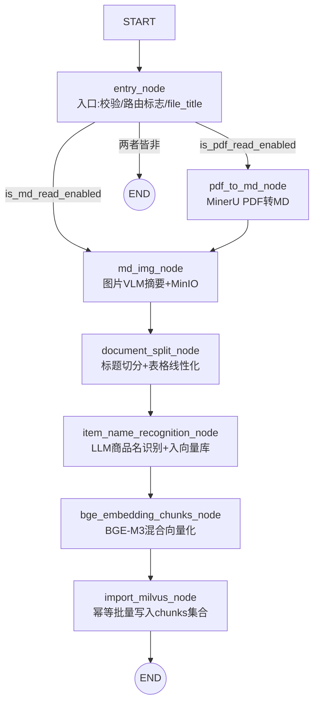

# 导入流程（import_processor）完整链路文档

> LangGraph 构建的文档导入流水线：把 PDF/MD 产品文档解析、切分、识别商品名、向量化，最终写入 Milvus 供查询链路检索。

---

## 1. 总览

```
输入: import_file_path(PDF/MD 文件) + file_dir(工作目录)
输出: Milvus chunks 集合(文档块混合向量) + item_name 集合(商品名向量) + 回填后的 state
```

主图入口：`main_graph.py` → `create_import_graph()` / `run_import_graph(import_file_path, file_dir)`

---

## 2. 流程图



注册 key（`main_graph.py` nodes 字典）与节点类对应关系：

| 图注册 key | 节点类 | 文件 |
|---|---|---|
| `entry_node` | `EntryNood` | `nodes/entry.py` |
| `pdf_to_md_node` | `PdfToMdNode` | `nodes/pdf_to_md.py` |
| `md_img_node` | `MarkDownImageNode` | `nodes/img_md.py` |
| `document_split_node` | `DocumentSplitNode` | `nodes/document_split.py` |
| `item_name_recognition_node` | `ItemNameRecognitionNode` | `nodes/item_name_recognition.py` |
| `bge_embedding_chunks_node` | `BgeEmbeddingChunksNode` | `nodes/bge_embedding.py` |
| `import_milvus_node` | `ImportMilvusNode` | `nodes/import_milvus.py` |

条件路由：`entry_router(state)` —— `is_pdf_read_enabled → pdf_to_md_node`；`is_md_read_enabled → md_img_node`；否则直接 `END`。

---

## 3. 节点逐个说明（完整链路）

### 3.1 entry_node —— 入口节点

```
外部传入 import_file_path + file_dir
        ↓
校验文件路径与目录非空
        ↓
识别文件扩展名(.pdf / .md)
        ↓
设置路由标志(is_pdf_read_enabled / is_md_read_enabled)
        ↓
提取文件标题 file_title 写入 state → 交给条件路由分发
```

- **读**：`import_file_path`、`file_dir`
- **写**：`file_title`、`is_pdf_read_enabled`、`is_md_read_enabled`
- 不支持的扩展名 → 两个标志都为 False → 图直接 END。

### 3.2 pdf_to_md_node —— PDF 转 Markdown

```
import_file_path + file_dir
        ↓
校验路径
        ↓
调用 MinerU 子进程解析 PDF(输出 md + images + 中间产物)
        ↓
state['md_path'] = 转换后的 md 路径 → 交给 md_img_node
```

- **读**：`import_file_path`、`file_dir`
- **写**：`md_path`
- MinerU 产物目录：`{file_dir}/{文件名}/auto/`，含 `*.md`、`images/*.jpg`、`*_content_list.json`、`*_middle.json` 等。
- MD 文件直接导入时跳过本节点（路由标志控制）。

### 3.3 md_img_node —— 图片处理（VLM 摘要 + MinIO）

```
md_path
        ↓
读取 md 内容,扫描图片引用与上下文(上下文最大 img_content_length=200 字符)
        ↓
逐张调用 VLM 生成图片摘要(受速率限制 requests_per_minute=10)
        ↓
图片上传 MinIO,md 中的本地图片路径替换为远程 URL + VLM 摘要文本
        ↓
state['md_content'] = 处理后的 md 全文 → 交给 document_split_node
```

- **读**：`md_path`（或 MD 导入时的 `import_file_path`）
- **写**：`md_content`
- ⚠️ **表格不在本节点处理**：mineru 输出的 `<table>` HTML 以文本形式留在 md 里，本节点正则只匹配 `` 图片语法。

### 3.4 document_split_node —— 文档切分

```
md_content + file_title
        ↓
校验 / 统一换行符
        ↓
按 h1-h6 标题结构切分章节
        ↓
长章节递归切分(超长先做表格线性化 MarkdownTableLinearizer.process)
短章节向后合并(目标区间 min~max: 500~1000 字符,重叠 1 句)
        ↓
组装 chunks: [{chunk_id?, title, parent_title, content, file_title, ...}]
        ↓
state['chunks'] → 交给 item_name_recognition_node(本地备份 chunks1_split.json)
```

- **读**：`md_content`、`file_title`
- **写**：`chunks`（list[dict]）
- **表格降维**：`utils/markdown_util.py` 的 `MarkdownTableLinearizer` 把 `<table>`/`|md表|` 展开 rowspan/colspan 后拍平成
  `- 【主体】：表头1为值1，表头2为值2。` 式自然语言文本，保证 embedding 可检索。

### 3.5 item_name_recognition_node —— 商品名识别

```
chunks(已有 title + content) + file_title
        ↓
拼接前 k 个 chunk 内容作为 LLM 识别上下文(k=item_name_chunk_k=3, 截 2500 字符)
        ↓
LLM 识别商品名(失败/空值降级为 file_title)
        ↓
BGE-M3 将商品名向量化(dense 1024 维 + sparse)
        ↓
商品名向量存入 milvus item_name 集合(按 file_title 先删旧记录再插入,保证幂等)
        ↓
回填 item_name 到每个 chunk 与 state → 交给 bge_embedding_chunks_node(备份 chunks2_item_name.json)
```

- **读**：`chunks`、`file_title`
- **写**：`item_name`；每个 chunk 增加 `item_name` 字段；Milvus `item_name_collection` 集合更新
- 幂等：集合主键 `pk` 是 `auto_id VARCHAR`，重复导入会累积，因此插入前按 `file_title` filter 删除旧记录（依赖 `file_title` 的 INVERTED 索引）。

### 3.6 bge_embedding_chunks_node —— chunk 混合向量化

```
上一节点传出的 chunks
        ↓
批量 BGE-M3 encode_documents(is_query=False)
        ↓
每个 chunk 附加 dense_vector(1024 维) + sparse_vector(dict{token_id: weight}, CSR 解析而来)
        ↓
state['chunks'] 更新 → 交给 import_milvus_node
```

- 稀疏向量：`csr_array` → `dict(zip(token_ids, weights))`，供 Milvus 混合检索做精确词项匹配（"UT890D+" ↔ "UT890D+"）。

### 3.7 import_milvus_node —— 写入 chunks 集合（终点）

```
chunks(已有 dense_vector + sparse_vector)
        ↓
参数校验:过滤无混合向量的无效块,确定向量维度 dim
        ↓
获取 milvus 客户端,确保集合存在(不存在则构建 schema + 索引并创建)
        ↓
幂等处理:提取 file_title 集合,按 file_title 删除旧记录,避免重复数据
        ↓
批量插入 milvus → 回填自增 chunk_id 到每个 chunk(zip(chunks, ids))
        ↓
state['chunks'] 更新 → 导入流程结束
```

- 集合不存在时用建造者构建：`_MilvusSchemaBuilder`（schema）+ `_MilvusIndexBuilder`（索引）+ `_MilvusInsertBuilder`（删除+插入）。
- `ensure_has_collection(delete_flag=True)` 可强制 drop 重建（schema 变更后需一次性使用）。

---

## 4. 状态字段（`state.py` → `ImportGraphState`，TypedDict total=False）

| 字段 | 类型 | 产生节点 | 说明 |
|---|---|---|---|
| `task_id` | str | 外部 | 任务追踪 ID |
| `is_pdf_read_enabled` / `is_md_read_enabled` | bool | entry | 条件路由标志 |
| `import_file_path` | str | 外部 | 待导入 PDF/MD 路径 |
| `file_dir` | str | 外部 | 工作/产物目录 |
| `pdf_path` / `md_path` | str | entry / pdf_to_md | 中间文件路径 |
| `file_title` | str | entry | 文件标题（幂等删除依据） |
| `item_name` | str | item_name_recognition | 识别出的商品名 |
| `md_content` | str | md_img | 图片替换后的 md 全文 |
| `chunks` | list[dict] | document_split 起，逐节点增强 | 最终含 content/title/parent_title/file_title/item_name/dense_vector/sparse_vector/chunk_id |

初始状态由 `create_default_state(**overrides)` 深拷贝 `GRAPH_DEFAULT_STATE` 生成。

---

## 5. 存储层数据结构

### 5.1 Milvus `chunks_collection`（env: `CHUNKS_COLLECTION`，如 kb_chunks_v1）

| 字段 | 类型 | 备注 |
|---|---|---|
| `chunk_id` | INT64 VARCHAR 主键 auto_id | 插入后回填 |
| `content` / `title` / `parent_title` / `file_title` / `item_name` | VARCHAR(65535) | 标量字段显式注册（`_SCALAR_FIELDS` tuple 保序） |
| `dense_vector` | FLOAT_VECTOR(1024) | AUTOINDEX / COSINE |
| `sparse_vector` | SPARSE_FLOAT_VECTOR | SPARSE_INVERTED_INDEX / IP |
| 其他未声明字段 | 动态字段 | `enable_dynamic_field=True`（注意参数名无下划线前缀） |

索引：以上向量索引 + `file_title` INVERTED（filter 删除必需，VARCHAR 无索引不能参与 filter）。

### 5.2 Milvus `item_name_collection`（env: `ITEM_NAME_COLLECTION`）

| 字段 | 类型 |
|---|---|
| `pk` | VARCHAR(100) 主键 auto_id |
| `file_title` / `item_name` | VARCHAR(65535) |
| `dense_vector` | FLOAT_VECTOR(1024), AUTOINDEX/COSINE |
| `sparse_vector` | SPARSE_FLOAT_VECTOR, SPARSE_INVERTED_INDEX/IP |
| 索引 | 上述 + `file_title` INVERTED |

### 5.3 MinIO

- bucket: env `MINIO_BUCKET_NAME`；图片对象名 `{file_title}/{图片hash}.jpg`
- md 中的图片引用被替换为 `http://{minio_endpoint}/{bucket}/...` 远程 URL。

### 5.4 本地工作目录产物（`file_dir` 下）

```
{file_title}.pdf                        # 原始文件
{文件名}/auto/{文件名}.md                # MinerU 转换产物(含 images/)
chunks1_split.json                      # document_split 备份
chunks2_item_name.json                  # item_name_recognition 备份
```

---

## 6. 关键配置（`config.py` → `ImportConfig`，均支持 .env 覆盖）

| 配置 | 默认 | 作用 |
|---|---|---|
| `max_content_length` / `min_content_length` | 1000 / 500 | 切分长度区间（长切短合） |
| `img_content_length` | 200 | 图片上下文截取长度 |
| `overlap_sentences` | 1 | 句子级切分重叠 |
| `item_name_chunk_k` / `item_name_chunk_size` | 3 / 2500 | 商品名识别上下文规模 |
| `embedding_dim` | 1024 (env `EMBEDDING_DIM`) | dense 向量维度 |
| `embedding_batch_size` | 8 | 向量化批量 |
| `requests_per_minute` | 10 | VLM 图片摘要限速 |
| `image_extensions` | jpg/jpeg/png/gif/bmp/webp | 可处理图片 |
| `qwen_base_url` / `qwen_api_key` / `vl_model` / `item_model` / `default_model` | env | LLM/VLM |
| `milvus_url` / `chunks_collection` / `item_name_collection` | env | Milvus |
| `minio_*` | env | MinIO |

---

## 7. 运行方式

```python
from knowledge.processor.import_process.main_graph import run_import_graph

final_state = run_import_graph(
    import_file_path=r"...temp_dir\万用表RS-12的使用.pdf",
    file_dir=r"...temp_dir",
)
```

- 直接运行 `main_graph.py` 的 `__main__` 即可跑通全链路（打印用 `_brief_state` 摘要长向量字段）。
- 幂等保证：**同一 `file_title` 重复导入 = 覆盖式更新**（chunks 集合与 item_name 集合都会先删后插）。

---

## 8. 已知问题与注意事项

1. **schema 变更后旧集合冲突**：报 `create duplicate collection with different parameters` 时，需临时 `delete_flag=True` 或手动 `drop_collection` 重建（chunks 与 item_name 两个集合都要检查 `file_title` INVERTED 索引是否存在）。
2. **`EntryNood.name = "entry"` 与注册 key `"entry_node"` 不一致**：stream 模式调试时日志节点名对不上，建议统一。
3. **VLM 模型名**必须是 DashScope 兼容模式的有效值（如 `qwen-vl-max`），配错会在 md_img_node 静默降级。
4. 商品名识别失败会**降级为 `file_title`**，下游查询链路的商品名匹配可能受影响（导入时尽量保证文档前几个 chunk 含明确型号）。
